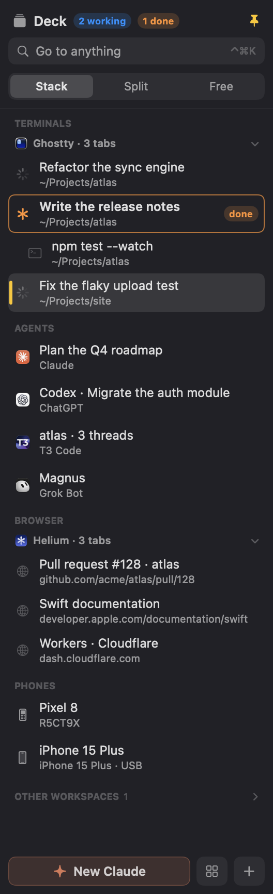

<p align="center">
  
</p>

<h1 align="center">BaneySpaces</h1>

<p align="center">
  <a href="https://github.com/baney75/baneyspaces/actions/workflows/ci.yml"></a>
  <a href="https://github.com/baney75/baneyspaces/releases/latest"></a>
  
  <a href="LICENSE"></a>
</p>

<p align="center">
  <b>Nine workspaces. One row of keys. Nothing to configure.</b><br>
  ⌘1 through ⌘9 takes you there. Add ⇧ and the window comes with you.<br>
  The Deck lists every terminal, tab and coding agent, and agents get a workspace of their own.<br>
  <sub><a href="https://dbaney.com/baneyspaces/">dbaney.com/baneyspaces</a> · Made by <a href="https://dbaney.com">Donovan Baney</a> · <a href="https://x.com/baney75">@baney75</a> · macOS 13 or later</sub>
</p>

<p align="center">
  
</p>

```sh
curl -fsSL https://raw.githubusercontent.com/baney75/baneyspaces/main/install.sh | bash
```

---

macOS already has desktops. Switching between them takes a swipe and an animation, and a
window can't be sent to one without dragging it through Mission Control. Tiling window managers
fix that, then take over your layout in exchange.

BaneySpaces does the one part you wanted. Your windows stay exactly where you put them, at the
size you made them. You just get nine places to put them and a key for each.

## How it works

| Keys | What happens |
| --- | --- |
| ⌘1 – ⌘9 | Go to that workspace. |
| ⌘⇧1 – ⌘⇧9 | Send the front window to that workspace and follow it. |
| Mission Control key, or ⌃↑ | See all nine workspaces at once. |

Prefer to keep ⌘1 for your browser's first tab? Pick ⌃, ⌥ or ⌃⌥ in setup instead.

- **It's instant.** No animation and no slide. The workspace is on screen when your finger
  leaves the key.
- **Nothing tiles.** Every window keeps its own position and size.
- **New windows open where you are.** Open something on workspace 4 and it lives on workspace 4.
- **The Dock and ⌘Tab still work.** Click an app whose window is on workspace 6 and you go to
  workspace 6.
- **Full screen works, and ⌘1–⌘9 still work from it.** Put a video or a slideshow in full screen
  as usual. Press ⌘2 and the window leaves full screen before you switch, so it stays on its
  workspace instead of stranding you on a macOS desktop that ⌘1–⌘9 can't reach.
- **Empty means empty.** Go to a workspace with nothing on it and you get a clean desktop.
  Typing goes nowhere until you open something.

## See everything at once

Press the Mission Control key (F3 on Apple keyboards) or ⌃↑, and BaneySpaces shows all nine
workspaces in the same 3×3 grid as the number keys, with every window's app and title.

- **Click a workspace,** or press its number, to go there. The arrow keys move the highlight
  and Return goes to it.
- **Click a window** to go straight to it.
- **Drag a window** onto another workspace to move it. The card follows your cursor and the
  workspace it will land on lights up.
- **Esc,** or the same key again, puts you back where you were.
- **Drag a window up to the top of the screen** and the overview opens in place of Mission
  Control, with the window's card under your pointer. Let go over a workspace to send the window
  there, in the same spot you picked it up from; let go anywhere else and it stays where it is.
  While this is on, macOS's own Mission Control and fill-the-screen for that drag are off; turn
  it off under **Settings › Keys** and they come back as they were.

<p align="center">
  
</p>

The menu bar icon shows the number of the workspace you're on. Its menu lists the workspaces in
use and one empty one to start fresh on; the switches and **Bring Every Window Back** sit under
**Options**.

## Workspace Dock

Turn on **Workspace Dock** in setup or under **Options** in the menu bar menu and the Dock shows your workspaces
instead of your apps. Rest the pointer on the bottom edge of the screen and it slides up: a
tile for each workspace in use, plus the one you're on, each with its apps and its number.
Click an app's icon to go straight to that app (again for its next window), or the tile around
it to go to the workspace. Rest on an app with several windows and a strip of them opens over
it, each labeled with its title, to pick one;
hover to see what's there. Right-click a tile to move the front window there, or an app to show
or quit it (hold ⌥ for **Force Quit**). Drag an app's icon onto
another tile to move its windows on that workspace there, or drag one window out of the strip to
move just that one; drop it on the dashed tile to start a new workspace with it. Drag any window
by its title bar down to a bottom dock and it comes up; let go on a tile (or the dashed one) and the
window goes to that workspace, back where you picked it up. Dragging a file,
link or image from another app brings the dock up too: hold it over an app's icon and that
app's window comes forward, or over a tile and you go to that workspace, then drop it into the
window. Drop a file or link on an app's icon and that app opens it, if it can. A tile with more than four apps shows three
and a "+N"; rest on the "+N" to list the rest and click one. You stay where
you are. The dashed tile goes to
the first empty workspace, and the two small buttons at the end open the launcher and the
overview of all nine.

It can sit on any side of the screen: choose **Bottom**, **Left**, **Right** or **Top** in setup,
in the menu bar menu under **Options › Dock Position**, or from the dock's right-click menu. At the
top it sits under the menu bar and waits half a second before opening, so reaching for a menu
doesn't bring it up. A dock with more tiles than the screen has room for shrinks to fit.

While it's on, the macOS Dock stays out of sight. BaneySpaces saves the Dock's own hiding
settings first and puts them back exactly when you turn the Workspace Dock off or quit. If
BaneySpaces ever crashed with it on, open BaneySpaces again (or run the uninstaller) and the
Dock comes back; by hand, `defaults delete com.apple.dock autohide-delay; killall Dock` gives the Dock its usual delay.

## ⌘Tab across workspaces

macOS's ⌘Tab only reaches apps on the workspace you're on. In setup, set **⌘Tab switches** to
**Apps on every workspace** and it steps through every app with a window, most recently used
first, each marked with the workspace it's on. Let go of ⌘ and you're on that app's window,
wherever it is. **Workspaces** steps through workspaces instead. ⌘⇧Tab steps back; Esc cancels.

On an app with more than one window, **hold Tab** to open its window bar (the highlight stays put; a tap steps when you let go): each window by title
(a browser's tab, a player's video) and workspace. Tab through it and let go to land on that
window; hold Tab again to go back to the apps.

## The Deck



The Deck is a sidebar for everything you work in on this workspace: each terminal split, each
browser tab, and each coding agent's window, in one list. It works with the apps you already
use. Ghostty, Terminal and iTerm show their tabs and splits; your default browser (Helium,
Chrome, Arc, Brave, Edge or Vivaldi) shows its tabs; Claude, ChatGPT, T3 Code, Cursor and Grok
Bot show their windows; any other app can be added by bundle ID. Phones are on it too.

In a terminal, browser or agent app, rest the pointer on the left edge of the screen, or press
**⌃⌘B**. Click a row to go there: the window comes forward at once, then the tab or split
inside it. It hides when you leave it. Pin it and it stays, docked beside your windows:

- **Stack** puts every wrapped window in the same frame beside the sidebar, so picking a row
  works like picking a tab.
- **Split** puts the row you pick on the right and the one before it on the left.
- **Free** leaves your windows where they are.

It knows what your agents are doing. A spinner means a Claude Code or Grok session is working,
✱ means it's waiting for you, and an orange **done** means it finished while you were looking
somewhere else. When that happens in another app, a small notice says so in the corner of the
screen; click it, or press **⌃⌘U** from anywhere in the deck, to go there. The menu bar icon
counts them, and each Workspace Dock tile shows an orange count for agents done there and a
blue dot while one works. ⌃⌘[ and ⌃⌘] go back and forward through the rows you've visited.

**⌃⌘K** finds anything by name: a split, a tab, an agent, a command. The launcher (⌘Space)
finds them too, with finished agents listed first.

Agents report their state through hooks. Turn them on once, from the sidebar's banner or with
`baneyspaces hooks install`, which adds them beside your own in `~/.claude/settings.json` and
in `~/.grok/hooks`. Without hooks the Deck reads Claude's terminal title instead.

## Launcher

One box to open, find, install and remove apps. Open it from the menu bar menu or the Workspace
Dock, or turn on **⌘Space opens the BaneySpaces launcher** in setup to use it in place of
Spotlight. Turning that off gives ⌘Space back to Spotlight, and so does quitting BaneySpaces.

- **Type** to search apps, commands and workspaces at once. An app that's already open takes you
  to the workspace it's on.
- **Tab** into a menu: **Apps**, **Install**, **Remove**, **Update**, **System** (lock, sleep,
  restart, dark mode, screenshot) or **Workspaces**. Delete on an empty search goes back.
- **Install** searches Homebrew's whole app list and the Mac App Store. Return installs a
  Homebrew app in the background and tells you when it's ready; an installer that needs your
  password finishes in Terminal, where you can see it. App Store results open in the App Store.
  No Homebrew yet? The first row installs it, in Terminal.
- **Remove** lists apps Homebrew installed and asks before uninstalling one.
- **⌘Return** shows an app in Finder, or a Homebrew app's web page.
- **Search the web and ask agents.** Type anything and the launcher offers your search engine,
  an image search and your agent. Start with **?** to ask your agent (Claude unless you pick
  another in setup); it opens a new chat in your default browser with the question asked.
- **Bangs**, as on DuckDuckGo: `!yt cats`, `!i sunsets`, `!w Erie`, `!gh baneyspaces`,
  `!claude why is the sky blue`, or the bang at the end (`cats !yt`). Type `!` to see them all;
  Tab fills one in. A bang that isn't built in goes to DuckDuckGo, which knows thousands.
  Agents: `!claude`, `!chatgpt`, `!pplx`, `!grok`, `!copilot`, `!lechat`.
- **Coding agents in your terminal.** Type `claude` or `codex` and, if it's installed, the
  launcher offers to start Claude Code or Codex in your terminal, in your home folder. That's
  the app that opens `.command` files, or Ghostty, iTerm2, WezTerm or Warp when that's still
  Terminal and one of them is installed.

### Your own bangs

Add them in setup under **Find and install apps › Your bangs**: a trigger, a name, and the
search address with `{q}` where the words go. One with a built-in's trigger replaces it.

Scripts and agents can manage them from a terminal:

```sh
B=~/Applications/BaneySpaces.app/Contents/MacOS/BaneySpaces
$B --bangs add jira Jira 'https://acme.atlassian.net/browse/{q}'
$B --bangs add ask Claude 'https://claude.ai/new?q={q}' --agent
$B --bangs list
$B --bangs remove jira
```

They live in `~/Library/Application Support/BaneySpaces/bangs.json`
(`[{"trigger": "jira", "name": "Jira", "url": "https://…/{q}", "agent": false}]`). Only
`https`, `http` and Apple Maps addresses are accepted.

## Your windows are safe

A window on another workspace isn't minimized, closed or moved. BaneySpaces hides its app, the
same as ⌘H, so it drops out of sight and out of Mission Control while it keeps running and
playing audio. When one app has windows on two workspaces, the window that doesn't belong here
steps just off screen and comes back to the exact spot it left.

- **Quit BaneySpaces** and every window comes back to where it was.
- **If BaneySpaces crashes,** the next launch shows every app it hid and puts back any window it
  moved.
- **Bring Every Window Back** (menu bar menu › **Options**) gathers every window onto workspace 1, all visible.
  It gets you out of any tangle.

## Install

Requires macOS 13 Ventura or later, on Apple silicon or Intel. In Terminal:

```sh
curl -fsSL https://raw.githubusercontent.com/baney75/baneyspaces/main/install.sh | bash
```

The installer builds BaneySpaces from source with Apple's free command line tools and copies it
to `~/Applications`. If the tools are missing, it opens Apple's installer for them first (about
1 GB, usually 5 to 15 minutes); paste the command again when that finishes. Because the app is
built on your Mac, there is no "unidentified developer" warning. If the build fails, the
installer shows the error and where the full log is.

Prefer to read the source first? Build it yourself:

```sh
git clone https://github.com/baney75/baneyspaces.git
cd baneyspaces
make install
```

<p align="center">
  
</p>

Then a setup window opens. There is one thing you have to do:

1. **Click Allow BaneySpaces.** macOS shows its own prompt and opens Privacy & Security ›
   Accessibility with BaneySpaces already in the list. Turn on its switch and come back.
   Accessibility lets BaneySpaces show, hide and move other apps' windows; it can't read what
   you type.

Setup notices the switch within a moment, says **BaneySpaces is on. Try ⌘2.**, and closes itself.
Everything else is optional and already set sensibly:

- **Your keys.** ⌘ by default, or ⌃, ⌥ or ⌃⌥ with what each one gives up. macOS uses ⌘⇧3, ⌘⇧4
  and ⌘⇧5 for screenshots and claims them first; **Free Them** turns those off so they can move
  windows (⌃⌘⇧3 and ⌃⌘⇧4 still capture to the clipboard), and **Turn Them Back On** undoes it.
- **See every workspace at once.** The Mission Control key and ⌃↑ open the overview, or switch
  that off to keep them for Mission Control.
- **Start with your Mac.** On unless you turn it off. If macOS wants you to approve it, setup
  shows a button that opens Login Items.

If AeroSpace is running, setup shows a **Quit AeroSpace** step, since both want the same keys.
The installer also quits it and turns off its open-at-login setting. AeroSpace stays installed.

Open setup again any time from the menu bar icon, or by opening BaneySpaces from Finder or
Spotlight.

### Updates

BaneySpaces looks for a new version once a day and, when there is one, the menu bar menu shows
**Update to BaneySpaces …**. Nothing installs until you press **Update Now** in the window that
shows what changed. The update builds on your Mac the same way the first install did, so the
Accessibility permission carries over, then BaneySpaces restarts and shows the release notes.
If the build fails, BaneySpaces keeps running as it was and offers the log.

Pick what you follow under **Updates** in the menu:

- **Stable** (the default): tagged releases, each one tested and described in the
  [changelog](CHANGELOG.md).
- **Nightly**: a build of the newest code, published each night something changed. Its notes
  list what's coming in the next release and every change since the last one. Switching back
  to Stable waits for a stable release newer than the nightly you have, so you never go
  backwards.

The daily check asks GitHub's public release list and sends nothing about your Mac. Turn it off
under **Updates › Check for Updates Daily** and use **Check for Updates Now…** instead.

### If the permission won't take

macOS ties the Accessibility switch to the app's signature. If you reinstalled, or the local
signing key had to be replaced, the switch can show on while macOS still says no. Setup spots
this a few seconds after you click Allow and offers **Fix Permission**, which clears the old
entry and asks again. By hand it is:

```sh
tccutil reset Accessibility com.baney.baneyspaces
```

If you turn the permission off while BaneySpaces is running, it brings every hidden window back,
hands the shortcuts back to your other apps and reopens setup.

## Scripting

The same actions are open to scripts and other tools:

```sh
open baneyspaces://switch/2     # go to workspace 2
open baneyspaces://move/5       # send the front window to workspace 5
open baneyspaces://restore      # bring every window back onto workspace 1
open baneyspaces://viewer       # show or hide the overview
```

`~/Library/Application Support/BaneySpaces/state.json` always holds the current workspace and
the apps on each one.

The `baneyspaces` command (installed in `~/.local/bin`) talks to the Deck in a few milliseconds:

```sh
baneyspaces ls                     # every split, tab, agent and phone, with IDs
baneyspaces focus helium github    # go to the best match, or an ID from ls
baneyspaces send <id> "npm test"   # type into a Ghostty terminal, as if pasted
baneyspaces notify "Need a call"   # light up the terminal this runs in
baneyspaces doctor                 # what's working and what isn't
```

`baneyspaces skill install` teaches Claude Code the same commands.

## Agents work beside you

Turn on the agent workspace and agents get a workspace of their own (9 unless you pick
another) to drive real apps on while you work on yours:

```sh
baneyspaces agent on                              # workspace 9 becomes the agent workspace
baneyspaces agent run --dir ~/Projects/atlas -- claude   # a Claude Code session there
baneyspaces agent open TextEdit notes.txt         # an app, or files in it, there
baneyspaces agent status                          # what's there, with window IDs
```

Three rules keep it from ever taking your screen. Its apps are parked out of view instead of
hidden, so automation that works from behind (Cua's driver) can click and type in them. Nothing
on it coming forward takes you there: you go with ⌘9, its Dock tile or a Deck row. And a window
an agent opens in the background lands there, not on your workspace. `agent run` starts a
Ghostty of its own for the agent, a separate process from yours, so nothing the agent does
there can stall your terminals. `scripts/agent-workspace-probe.sh` proves it on your Mac: an
agent's command runs there, cua-driver types into an app there, and only your own keyboard and
mouse change what you see.

The window IDs are the ones cua-driver uses, so an agent drives a window there with the usual
`get_window_state` and an `element_token`, never the foreground. A [fork of Cua's
driver](https://github.com/baney75/cua/tree/baneyspaces) goes one step further: it refuses
foreground delivery to a window on the agent workspace while you're elsewhere.

**Phones.** Android phones (USB debugging on) and iPhones show in the Deck the moment they're
plugged in. A row opens the phone's screen: scrcpy for Android, iPhone Mirroring for an iPhone.
Agents get `baneyspaces phone ui` (the screen's UI tree, to find a button by its text), `tap`,
`swipe`, `type`, `key`, `shot` and `shell` for Android. An iPhone is driven through its iPhone
Mirroring window: open it on the agent workspace and work it from behind like any other app.

**Other machines.** `baneyspaces remote on` lets your other machines send work to this one's
agent workspace over your tailnet: `baneyspaces --on <host> agent run -- claude`. It listens
only on this Mac's Tailscale address, every request needs the token from `baneyspaces remote
token`, and a remote machine can only look and start agent work. It can't focus, type into
your terminals, open pages or move your windows. macOS's firewall has to allow BaneySpaces
incoming connections first.

### Keep apps usable by automation

BaneySpaces hides an app whose windows all sit on other workspaces, the way ⌘H does. macOS
refuses background clicks and keystrokes to a hidden app, so tools that drive apps from behind,
such as [Cua](https://github.com/trycua/cua), can't use it until you switch back. Put the app
under **Options › Keep Usable by Automation** in the menu bar menu and its windows are parked just out of
view instead, where those tools can still click and type. Cua Spaces is on the list from the
start, so its picture-in-picture window stays put.

Parked windows never slide across the screen: they move behind the windows of the workspace you
go to, or while their app is hidden for a moment. Some apps animate every window move (Chromium
browsers such as Helium take a quarter second); BaneySpaces notices that once and hides such an
app as usual instead, and its menu entry says so.

## Limits

- **One set of workspaces covers every display.** ⌘3 changes what every screen shows.
- **Shortcuts stop while Secure Input is on.** When a password field or a terminal's secure
  keyboard entry holds Secure Input, macOS lets no other app see keystrokes. That applies to
  every global shortcut, not just these.
- **Windows on other macOS desktops are left alone.** Keep one macOS desktop in Mission Control
  and let the nine workspaces do the rest.
- **An agent pressing ⌘1–⌘9 in the foreground switches workspaces,** the same as you would.
  Background key delivery to one app (as Cua does by default) doesn't.

## Build from source

```sh
make test      # unit tests for the workspace model and screen math
make app       # build/BaneySpaces.app
make install   # build, install to ~/Applications, start
```

The app is signed with a local certificate that `scripts/signing-identity.sh` creates on first
build and keeps in its own keychain. Because the signature stays the same, macOS keeps the
Accessibility grant across rebuilds. The key is only replaced when it is truly unusable, and the
build says so, since a new key means allowing BaneySpaces again (setup's Fix Permission).

## Uninstall

In BaneySpaces: **Settings > General > Uninstall BaneySpaces…** (also in the menu bar icon's
Options). Or in Terminal:

```sh
curl -fsSL https://raw.githubusercontent.com/baney75/baneyspaces/main/uninstall.sh | bash
```

Both run the same script. BaneySpaces quits first, which brings every hidden window and app
back; if it won't quit, the uninstaller stops without deleting anything. Then it puts back what
BaneySpaces changed:

- the macOS Dock's own hide settings, if the Workspace Dock had it out of sight
- macOS's screenshot and Spotlight shortcuts, if setup or the launcher turned them off
- Claude Code's `~/.claude/settings.json`: only BaneySpaces' hooks come out; your own hooks and
  settings stay. Its first backup, from before BaneySpaces touched the file, stays beside it as
  `settings.json.baneyspaces-backup`.
- AeroSpace opening at login, if the installer turned that off

Ghostdeck, which BaneySpaces replaced, isn't put back: the installer moved Ghostdeck.app to the
Trash and its hooks became BaneySpaces' own, so both come out here.

And it removes the app, its login item, its Accessibility entry, its settings and local signing
key, the `baneyspaces` and `ghostdeck` commands in `~/.local/bin`, its Grok hook file and its
agent skill. Running it twice is safe. If something can't be put back (say the app was already
emptied from the Trash, so the shortcuts can't be turned back on), it still removes the rest,
lists what needs a hand, and keeps its record of it.

## License

MIT. See [LICENSE](LICENSE).

## Sponsors

<!-- sponsors:start -->
No sponsors yet. [Sponsor on GitHub](https://github.com/sponsors/baney75) and your name appears here automatically.
<!-- sponsors:end -->
