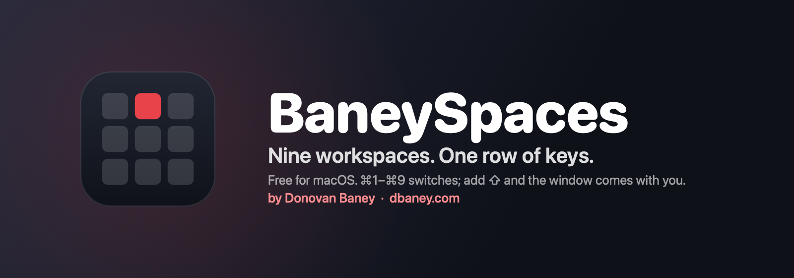
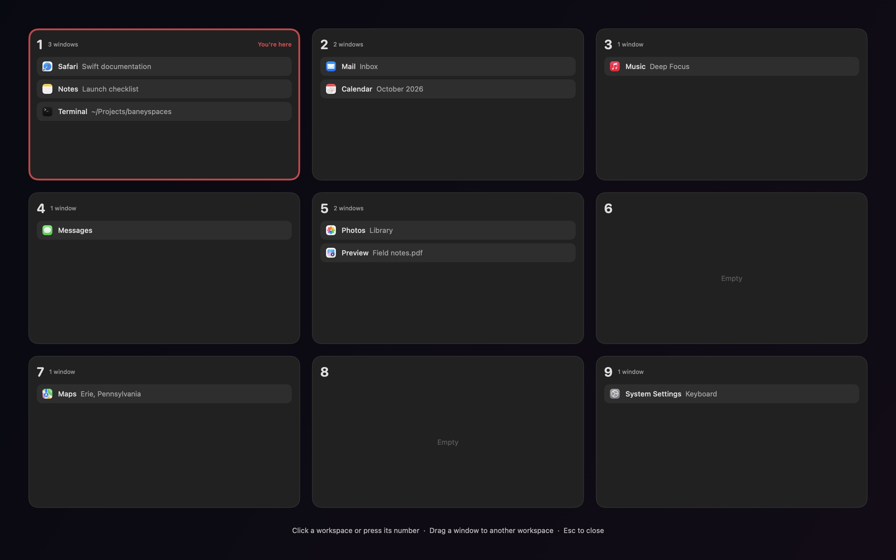
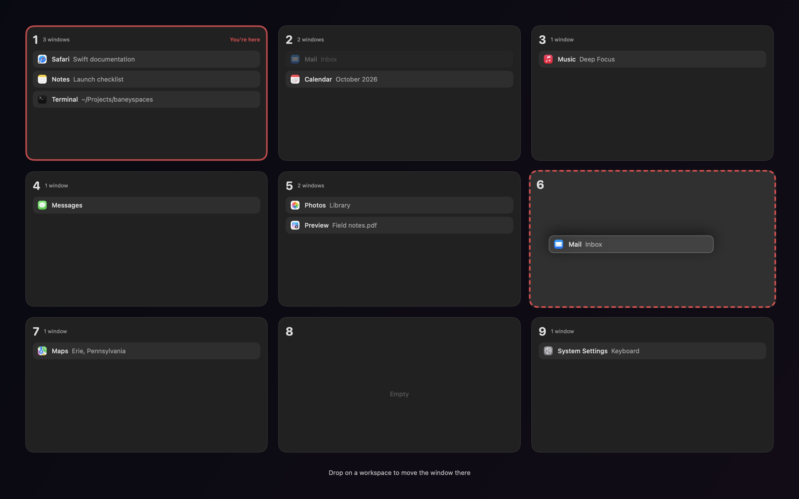
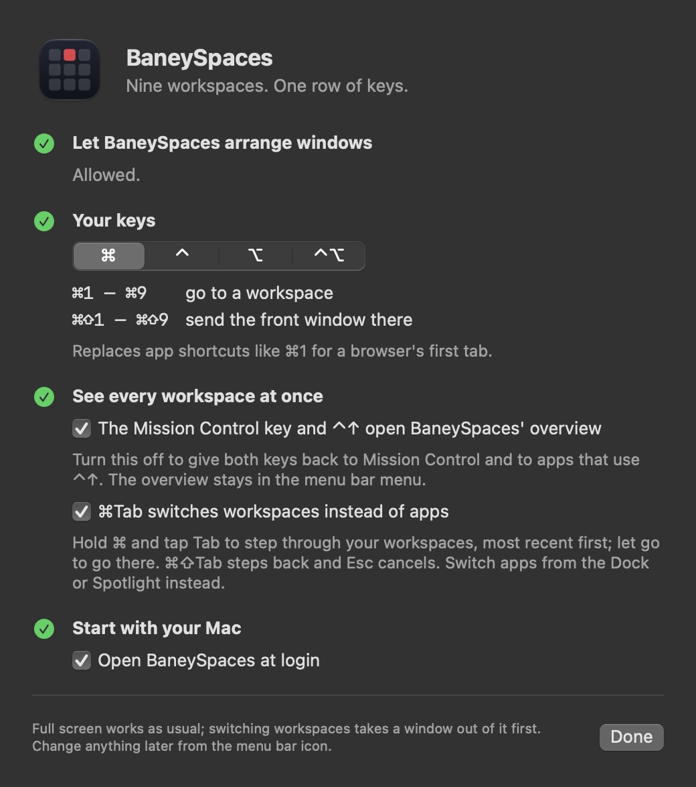

<p align="center">
  
</p>

<h1 align="center">BaneySpaces</h1>

<p align="center">
  <a href="https://github.com/baney75/baneyspaces/actions/workflows/ci.yml"></a>
  <a href="https://github.com/baney75/baneyspaces/releases/latest"></a>
  
  <a href="LICENSE"></a>
</p>

<p align="center">
  <b>Nine workspaces. One row of keys. Nothing to configure.</b><br>
  ⌘1 through ⌘9 takes you there. Add ⇧ and the window comes with you.<br>
  The launcher finds every terminal, tab and coding agent, and agents get a workspace of their own.<br>
  <sub><a href="https://dbaney.com/baneyspaces/">dbaney.com/baneyspaces</a> · Made by <a href="https://dbaney.com">Donovan Baney</a> · <a href="https://x.com/baney75">@baney75</a> · macOS 13 or later</sub>
</p>

<p align="center">
  
</p>

```sh
curl -fsSL https://raw.githubusercontent.com/baney75/baneyspaces/main/install.sh | bash
```

---

macOS already has desktops. Switching between them takes a swipe and an animation, and a
window can't be sent to one without dragging it through Mission Control. Tiling window managers
fix that, then take over your layout in exchange.

BaneySpaces does the one part you wanted. Your windows stay exactly where you put them, at the
size you made them. You just get nine places to put them and a key for each.

## How it works

| Keys | What happens |
| --- | --- |
| ⌘1 – ⌘9 | Go to that workspace. |
| ⌘⇧1 – ⌘⇧9 | Send the front window to that workspace and follow it. |
| Mission Control key, or ⌃↑ | See all nine workspaces at once. |

Prefer to keep ⌘1 for your browser's first tab? Pick ⌃, ⌥ or ⌃⌥ in setup instead.

- **It's instant.** No animation and no slide. The workspace is on screen when your finger
  leaves the key.
- **Nothing tiles.** Every window keeps its own position and size.
- **New windows open where you are.** Open something on workspace 4 and it lives on workspace 4.
- **The Dock and ⌘Tab still work.** Click an app whose window is on workspace 6 and you go to
  workspace 6.
- **Full screen works, and ⌘1–⌘9 still work from it.** Put a video or a slideshow in full screen
  as usual. Press ⌘2 and the window leaves full screen before you switch, so it stays on its
  workspace instead of stranding you on a macOS desktop that ⌘1–⌘9 can't reach.
- **Empty means empty.** Go to a workspace with nothing on it and you get a clean desktop.
  Typing goes nowhere until you open something.
- **Each display has a workspace of its own.** With a second monitor or Sidecar, ⌘1–⌘9 change
  only the display you're on: the one you last clicked (a window, the desktop, the Workspace
  Dock or the overview), or whose window you switched to. The other keeps showing its workspace.
  Press the number of the workspace the other display shows and you go there, as in AeroSpace.
  Drag a window onto the other display and it joins that display's workspace. A display you
  plug in shows an empty workspace; one you unplug takes its workspace out of sight until you
  go to it.

## See everything at once

Press the Mission Control key (F3 on Apple keyboards) or ⌃↑, swipe up with three or four fingers
on the trackpad (whichever your trackpad settings give Mission Control), or push the pointer into a
hot corner you had set to Mission Control, and BaneySpaces shows all nine workspaces in the same 3×3
grid as the number keys, with every window's app and title. A swipe down, Esc or the same key again
puts you back.

**macOS's Mission Control is replaced, not joined.** BaneySpaces switches it off in the Dock, so the
"Desktop" view never opens from the trackpad, a hot corner or the keys, and it remaps any hot corner
that was set to Mission Control to nothing and answers that corner itself. It saves what was there
first. To get Mission Control back, turn off **Settings › Keys › Use BaneySpaces' overview instead of
Mission Control**: every setting goes back exactly as it was. Quitting BaneySpaces and uninstalling
do the same, and the Dock restarts each time. If BaneySpaces stops without quitting (a crash, or
the app dragged to the Trash), a small launch agent puts Mission Control back once no BaneySpaces
has run for a minute (30 seconds after an update's restart that never came back). The agent stays
installed across quits, so macOS doesn't announce a new background item at every launch; it goes
when you turn the Settings switch off or uninstall, and does nothing while BaneySpaces isn't
holding Mission Control off. BaneySpaces
switches Mission Control off only after that agent is written, loaded and checked, and after what
was there is saved to disk; if either can't be done, Mission Control stays on and Settings says
why. If the agent is switched off later (the Background Item notice), BaneySpaces gives Mission
Control back instead of holding it off without a way back. Only a build that knows this takeover
counts as running: an older BaneySpaces started later does not keep Mission Control off. To get
Mission Control back yourself, turn off the Settings switch; if BaneySpaces isn't running, use
`defaults delete com.apple.dock mcx-expose-disabled; killall Dock` (and set any hot corner you had
on Mission Control back in System Settings). Doing that while BaneySpaces runs also works: it
notices within 20 seconds and switches its own overview off.

App Exposé (⌃↓) goes with Mission Control, and so does a Magic Mouse's two-finger double tap,
which opens nothing while this is on. The trackpad swipe uses macOS's private trackpad framework,
loaded when BaneySpaces starts and checked against the touches it gets; if macOS won't load it or
reports touches in a layout BaneySpaces doesn't read, Settings says so and the other ways in still
work. Only trackpads are watched, with each trackpad's own finger settings, and Show Desktop and
pinch gestures aren't taken for a swipe.

- **Click a workspace,** or press its number, to go there. The arrow keys move the highlight
  and Return goes to it.
- **Click a window** to go straight to it.
- **Drag a window** onto another workspace to move it. The card follows your cursor and the
  workspace it will land on lights up.
- **Esc,** or the same key again, puts you back where you were.
- **Drag a window up to the top of the screen** and the overview opens in place of Mission
  Control, with the window's card under your pointer. Let go over a workspace to send the window
  there, in the same spot you picked it up from; let go at the top itself and macOS fills the
  screen with it; let go anywhere else and it stays where it is. While this is on, Mission Control
  for that drag is off; turn it off under **Settings › Keys** and it comes back as it was.

<p align="center">
  
</p>

The menu bar icon shows the number of the workspace you're on. Its menu lists the workspaces in
use and one empty one to start fresh on, then **Show All Workspaces**, **Find or Install an App…**,
**Settings…** (⌘,) and **Quit BaneySpaces** (⌘Q). Two more rows appear only while there is
something to act on: **N Agents Finished While You Were Away** (a list; click one to go to it) and
**Update to …**. Every switch, **Bring Every Window Back**, the update controls and About live in
Settings, one click away.

## Workspace Dock

Turn on **Workspace Dock** under **Settings > Dock** and the Dock shows your workspaces
instead of your apps. Rest the pointer on the bottom edge of the screen and it slides up: a
tile for each workspace in use, plus the one you're on, each with its apps and its number.
Click an app's icon to go straight to that app (again for its next window), or the tile around
it to go to the workspace. Rest on an app with several windows and a strip of them opens over
it, each labeled with its title, to pick one;
hover to see what's there. Right-click a tile to move the front window there, or an app to show
or quit it (hold ⌥ for **Force Quit**). Drag an app's icon onto
another tile to move its windows on that workspace there, or drag one window out of the strip to
move just that one; drop it on the dashed tile to start a new workspace with it. Drag any window
by its title bar down to a bottom dock and it comes up; let go on a tile (or the dashed one) and the
window goes to that workspace, back where you picked it up. Dragging a file,
link or image from another app brings the dock up too: hold it over an app's icon and that
app's window comes forward, or over a tile and you go to that workspace, then drop it into the
window. Drop a file or link on an app's icon and that app opens it, if it can. A tile with more than four apps shows three
and a "+N"; rest on the "+N" to list the rest and click one. You stay where
you are. The dashed tile goes to
the first empty workspace, and the two small buttons at the end open the launcher and the
overview of all nine.

It can sit on any side of the screen: choose **Bottom**, **Left**, **Right** or **Top** under **Settings > Dock > Position on screen**, or from the dock's right-click menu. At the
top it sits under the menu bar and waits half a second before opening, so reaching for a menu
doesn't bring it up. A dock with more tiles than the screen has room for shrinks to fit.

While it's on, the macOS Dock stays out of sight. BaneySpaces saves the Dock's own hiding
settings first and puts them back exactly when you turn the Workspace Dock off or quit. If
BaneySpaces ever crashed with it on, open BaneySpaces again (or run the uninstaller) and the
Dock comes back; by hand, `defaults delete com.apple.dock autohide-delay; killall Dock` gives the Dock its usual delay.

### Colors and looks

**Settings › Appearance** changes how every panel looks, and the open ones change as you click. Pick
an accent (nine colors, **System** to follow macOS, or any color of your own), a palette for the
nine workspace colors (**Rainbow**, **Accent**, **Calm** or **Mono**) and your own color for any one
workspace, a panel style (**Glass**, **Tinted** or **Solid**) with an opacity slider, and a **Small**,
**Medium** or **Large** Workspace Dock. White numbers stay readable: a workspace color that's too
bright is dimmed. The defaults are the look BaneySpaces always had.

**Themes and palettes.** A theme is shape, type and motion; a palette is color; any theme takes any
palette, on every platform (`spec/themes.md`). **BaneySpaces** is the look above. **Omarchy** is
blocky like Omarchy's own Waybar and Hyprland: square corners, a solid 2 px border (your accent on
what's current), an opaque fill, no blur or shadow, a monospace font, numbered blocks for
workspaces, and fades only. **Minimal** is flat and small, with thin borders and a bar under each
workspace number. The palette is **Auto** (the panels' own dark look with your accent) or one of
Omarchy's 22. The dock, the "+N" list and window strip, ⌘Tab, the launcher, the overview, the menu bar
number and Settings all follow the theme, live. From a terminal:

```
baneyspaces set appearance.theme omarchy      # or baneyspaces, minimal
baneyspaces set appearance.palette gruvbox    # or auto
baneyspaces set dock.enabled false            # or true
baneyspaces get                               # all four
baneyspaces set behavior.fullscreen native    # or baneyspaces: the green button and ⌃⌘F fill the workspace
```

Agents may change these too, from this Mac or, with the remote token, from another one
(`BANEYSPACES_AGENT=<name>` names the caller). Each change is logged in `trace.log` with who made it.
Workspace and window commands stay yours.

**Turning the dock off** (**Settings › Dock**, the menu bar item, or `dock.enabled`) leaves no dock window
at all: nothing comes up at the edge, the "+N" list never opens, and a window dragged to the bottom
edge is left alone. Dragging to the top, the workspace keys, ⌘Tab, the launcher, the overview, the
agent workspace and the menu bar number all keep working. Turn it back on and the dock returns the
next time the pointer rests on its edge.

## ⌘Tab across workspaces

macOS's ⌘Tab only reaches apps on the workspace you're on. In setup, set **⌘Tab switches** to
**Apps on every workspace** and it steps through every app with a window, most recently used
first, each marked with the workspace it's on. Let go of ⌘ and you're on that app's window,
wherever it is. **Workspaces** steps through workspaces instead. ⌘⇧Tab steps back; Esc cancels.

On an app with more than one window, **hold Tab** to open its window bar (the highlight stays put; a tap steps when you let go): each window by title
(a browser's tab, a player's video) and workspace. Tab through it and let go to land on that
window; hold Tab again to go back to the apps.

## Agent status

BaneySpaces knows what your coding agents are doing. On the Workspace Dock, a turning ring on an
app's icon means a Claude Code or Grok session is working, a yellow **?** means it's asking you
something, a red **!** means it stopped on an error, and an orange count means agents finished
while you were looking somewhere else. When that happens in another app, a small notice says so
in the corner of the screen; click it, or press **⌃⌘U**, to go there. The menu bar icon counts
them too. Click a badged app on the dock and you land on that agent's tab or split.

Agents report their state through hooks. Turn them on once, from setup (Dock tab) or with
`baneyspaces hooks install`, which adds them beside your own in `~/.claude/settings.json` and
in `~/.grok/hooks`. Without hooks BaneySpaces reads Claude's terminal title instead.

## Launcher

One box to open, find, install and remove apps, and find files, terminal tabs and splits,
browser tabs and agent windows. **⌃⌘K** opens it from any app. You can also open it from the menu bar menu (**Find or Install an App…**) or the Workspace
Dock, or turn on **⌘Space opens the BaneySpaces launcher** in setup to use it in place of
Spotlight. Turning that off gives ⌘Space back to Spotlight, and so does quitting BaneySpaces.

- **Type** to search apps, files, commands and workspaces at once. An app that's already open
  takes you to the workspace it's on.
- **Terminals, tabs and agents.** Type part of a name and the launcher lists matching Ghostty,
  Terminal and iTerm tabs and splits, tabs in your default browser (Helium, Chrome, Arc, Brave,
  Edge or Vivaldi), and windows of Claude, ChatGPT, T3 Code, Cursor and Grok Bot. Return goes
  to it: the window comes forward at once, then the tab or split inside it. With nothing typed,
  the agents that finished or need you come first. **New Claude Session** and **New Terminal**
  are commands here too.
- **Files.** The best five files and folders whose names match come in under the apps; Tab into
  **Files** for more. Every word you type must start a word of the name (`tax 2025` or `ret tax`
  finds `2025 Tax Return.pdf`; words also break at `_` and in camelCase). It searches your home folder, iCloud Drive and other cloud drives
  through Spotlight, skipping Library, hidden folders and build folders such as `node_modules`.
  Return opens the file, **⌘Return** shows it in Finder. A folder Spotlight doesn't index
  (System Settings › Spotlight) won't show up. The first time a file in Documents, Desktop,
  Downloads or iCloud Drive comes up, macOS may ask to let BaneySpaces see that folder.
- **Tab** into a menu: **Apps**, **Files**, **Install**, **Remove**, **Update**, **System** (lock, sleep,
  restart, dark mode, screenshot) or **Workspaces**. Delete on an empty search goes back.
- **Install** searches Homebrew's whole app list and the Mac App Store. Return installs a
  Homebrew app in the background and tells you when it's ready; an installer that needs your
  password finishes in Terminal, where you can see it. App Store results open in the App Store.
  No Homebrew yet? The first row installs it, in Terminal.
- **Remove** lists apps Homebrew installed and asks before uninstalling one.
- **⌘Return** shows an app or file in Finder, or a Homebrew app's web page.
- **Search the web and ask agents.** Type anything and the launcher offers your search engine,
  an image search and your agent. Start with **?** to ask your agent (Claude unless you pick
  another in setup); it opens a new chat in your default browser with the question asked.
- **Bangs**, as on DuckDuckGo: `!yt cats`, `!i sunsets`, `!w Erie`, `!gh baneyspaces`,
  `!claude why is the sky blue`, or the bang at the end (`cats !yt`). Type `!` to see them all;
  Tab fills one in. A bang that isn't built in goes to DuckDuckGo, which knows thousands.
  Agents: `!claude`, `!chatgpt`, `!pplx`, `!grok`, `!copilot`, `!lechat`.
- **Coding agents in your terminal.** Type `claude` or `codex` and, if it's installed, the
  launcher offers to start Claude Code or Codex in your terminal, in your home folder. That's
  the app that opens `.command` files, or Ghostty, iTerm2, WezTerm or Warp when that's still
  Terminal and one of them is installed.

### Your own bangs

Add them in setup under **Find and install apps › Your bangs**: a trigger, a name, and the
search address with `{q}` where the words go. One with a built-in's trigger replaces it.

Scripts and agents can manage them from a terminal:

```sh
B=~/Applications/BaneySpaces.app/Contents/MacOS/BaneySpaces
$B --bangs add jira Jira 'https://acme.atlassian.net/browse/{q}'
$B --bangs add ask Claude 'https://claude.ai/new?q={q}' --agent
$B --bangs list
$B --bangs remove jira
```

They live in `~/Library/Application Support/BaneySpaces/bangs.json`
(`[{"trigger": "jira", "name": "Jira", "url": "https://…/{q}", "agent": false}]`). Only
`https`, `http` and Apple Maps addresses are accepted.

## Your windows are safe

A window on another workspace isn't minimized, closed or moved. BaneySpaces hides its app, the
same as ⌘H, so it drops out of sight and out of Mission Control while it keeps running and
playing audio. When one app has windows on two workspaces, the window that doesn't belong here
steps just off screen and comes back to the exact spot it left.

- **Quit BaneySpaces** and every window comes back to where it was.
- **If BaneySpaces crashes,** the next launch shows every app it hid and puts back any window it
  moved.
- **Bring Every Window Back** (**Settings > Automation**) gathers every window onto workspace 1, all visible.
  It gets you out of any tangle.

## Install

Requires macOS 13 Ventura or later, on Apple silicon or Intel. Two ways in:

**In Terminal**, one line. It downloads the ready-made app (a few MB, no developer tools),
checks that it is signed with BaneySpaces' release key, and copies it to `~/Applications` (or
replaces the copy you already have, wherever it is):

```sh
curl -fsSL https://raw.githubusercontent.com/baney75/baneyspaces/main/install.sh | bash
```

**From your browser**: download `BaneySpaces.dmg` from the
[latest release](https://github.com/baney75/baneyspaces/releases/latest) and drag BaneySpaces to
Applications. The first time you open it, macOS asks you to confirm in **System Settings ›
Privacy & Security › Open Anyway**, because BaneySpaces isn't notarized. The Terminal line
doesn't ask: a file downloaded by `curl` never gets that prompt. On its first launch from
Applications, BaneySpaces also does what the installer does: it turns AeroSpace's open-at-login
off, adds the `baneyspaces` command to `~/.local/bin` and moves Ghostdeck to the Trash.

A release without the ready-made app (the Nightly build, old releases), or
`BANEYSPACES_FROM_SOURCE=1`, builds from source instead with Apple's free command line tools. If
the tools are missing, the installer opens Apple's installer for them first (about 1 GB, usually
5 to 15 minutes); paste the command again when that finishes. If the build fails, the installer
shows the error and where the full log is.

The ready-made app and a source build are signed with different certificates, and macOS ties the
Accessibility permission to the signature. So if your BaneySpaces was built on your Mac, the
installer and the updater keep building it from source (the same signature, the permission stays),
as long as the command line tools are installed. Without them they replace it with the ready-made
app, and macOS asks for the Accessibility permission once more.

Prefer to read the source first? Build it yourself:

```sh
git clone https://github.com/baney75/baneyspaces.git
cd baneyspaces
make install
```

<p align="center">
  
</p>

Then a setup window opens. There is one thing you have to do:

1. **Click Allow BaneySpaces.** macOS shows its own prompt and opens Privacy & Security ›
   Accessibility with BaneySpaces already in the list. Turn on its switch and come back.
   Accessibility lets BaneySpaces show, hide and move other apps' windows; it can't read what
   you type.

Setup notices the switch within a moment, says **BaneySpaces is on. Try ⌘2.**, and closes itself.
Everything else is optional and already set sensibly:

- **Your keys.** ⌘ by default, or ⌃, ⌥ or ⌃⌥ with what each one gives up. macOS uses ⌘⇧3, ⌘⇧4
  and ⌘⇧5 for screenshots and claims them first; **Free Them** turns those off so they can move
  windows (⌃⌘⇧3 and ⌃⌘⇧4 still capture to the clipboard), and **Turn Them Back On** undoes it.
- **See every workspace at once.** The Mission Control key, ⌃↑, a three- or four-finger swipe up and
  any hot corner you had set to Mission Control open the overview in place of macOS's. Switch **Use
  BaneySpaces' overview instead of Mission Control** off to get Mission Control back as it was.
- **Start with your Mac.** On unless you turn it off. If macOS wants you to approve it, setup
  shows a button that opens Login Items.

If AeroSpace is running, setup shows a **Quit AeroSpace** step, since both want the same keys.
The installer also quits it and turns off its open-at-login setting. AeroSpace stays installed.

Open Settings again any time with **Settings…** (⌘,) in the menu bar icon's menu, or by opening BaneySpaces from Finder or
Spotlight.

### Updates

BaneySpaces looks for a new version once a day and, when there is one, the menu bar menu shows **Update to BaneySpaces …** (the row is there only while
a release is waiting) and so does **Settings > Updates**. Check by hand there with **Check for Updates Now…**. Nothing installs until you press **Update Now** in the window that
shows what changed. The update installs the same way the first install did, into the folder the
app is in. A stable release downloads the ready-made app; a Nightly build, or a copy that was
built on your Mac (while the command line tools are installed), is built on your Mac, so the
Accessibility permission carries over. Then BaneySpaces restarts and shows the release notes. If
the update fails, BaneySpaces keeps running as it was and offers the log.

Pick what you follow under **Settings > Updates**:

- **Stable** (the default): tagged releases, each one tested and described in the
  [changelog](CHANGELOG.md).
- **Nightly**: a build of the newest code, published each night something changed. It is built
  on your Mac, so it needs Apple's command line tools; without them Settings says so and Stable
  keeps working. Its notes
  list what's coming in the next release and every change since the last one. Switching back
  to Stable waits for a stable release newer than the nightly you have, so you never go
  backwards.

The daily check asks GitHub's public release list and sends nothing about your Mac. Turn it off
under **Settings > Updates > Check for updates daily** and use **Check for Updates Now…** instead.

### If the permission won't take

macOS ties the Accessibility switch to the app's signature. If you reinstalled, or the local
signing key had to be replaced, the switch can show on while macOS still says no. Setup spots
this a few seconds after you click Allow and offers **Fix Permission**, which clears the old
entry and asks again. By hand it is:

```sh
tccutil reset Accessibility com.baney.baneyspaces
```

If you turn the permission off while BaneySpaces is running, it brings every hidden window back,
hands the shortcuts back to your other apps and reopens setup.

## Scripting

The same actions are open to scripts and other tools:

```sh
open baneyspaces://switch/2     # go to workspace 2
open baneyspaces://move/5       # send the front window to workspace 5
open baneyspaces://restore      # bring every window back onto workspace 1
open baneyspaces://viewer       # show or hide the overview
```

`~/Library/Application Support/BaneySpaces/state.json` always holds the current workspace and
the apps on each one.

The `baneyspaces` command (installed in `~/.local/bin`) talks to BaneySpaces in a few milliseconds:

```sh
baneyspaces ls                     # every split, tab, agent and phone, with IDs
baneyspaces focus helium github    # go to the best match, or an ID from ls
baneyspaces send <id> "npm test"   # type into a Ghostty terminal, as if pasted
baneyspaces notify "Need a call"   # light up the terminal this runs in
baneyspaces doctor                 # what's working and what isn't
```

`baneyspaces skill install` teaches Claude Code the same commands.

## Agents work beside you

Turn on the agent workspace and agents get a workspace of their own (9 unless you pick
another) to drive real apps on while you work on yours:

```sh
baneyspaces agent on                              # workspace 9 becomes the agent workspace
baneyspaces agent run --dir ~/Projects/atlas -- claude   # a Claude Code session there
baneyspaces agent open TextEdit notes.txt         # an app, or files in it, there
baneyspaces agent status                          # what's there, with window IDs
```

Three rules keep it from ever taking your screen. Its apps are parked out of view instead of
hidden, so agents can still click and type in them from behind. Nothing
on it coming forward takes you there: you go with ⌘9, its Dock tile or a launcher row. And a window
an agent opens in the background lands there, not on your workspace. `agent run` starts a
Ghostty of its own for the agent, a separate process from yours, so nothing the agent does
there can stall your terminals. `scripts/agent-hands-probe.swift` (phase 1) proves it on your Mac: an
agent's command runs there, and only your own keyboard and mouse change what you see.

### The hands: snapshot an app, act on it, check the result

BaneySpaces is also the hands agents use there. They read an app's accessibility tree, act on what's in
it and check the result, all on the agent workspace and never in the foreground. Cua's driver is no longer
used. The engine is [agent-desktop](https://github.com/vercel-labs/agent-desktop) (Apache-2.0), built from a
pinned commit by `make install` and linked into the app; the scope and focus guards, the evidence and the
MCP server are BaneySpaces'.

```sh
baneyspaces agent open TextEdit notes.txt       # on the agent workspace; files only from the handoff folder; prints the window id
baneyspaces agent snapshot --app TextEdit -i    # refs for what an agent can act on
baneyspaces agent type @s8f3k2p9:e2 "Hello"     # act on a ref; the result carries what it read back
baneyspaces agent click|set-value|toggle|scroll|select|press <ref> …
baneyspaces agent find --window 4211 --role button --name Save
baneyspaces agent get @s8f3k2p9:e2 value        # check from the live element
baneyspaces agent shot --window 4211            # one window as a PNG in BaneySpaces' shots folder, even while parked (needs Screen Recording)
baneyspaces agent windows                       # the windows an agent may use right now
claude mcp add baneyspaces -- baneyspaces mcp   # the same tools over MCP, for Claude Code and Codex
```

You, not an agent, lend an app from your workspaces. `baneyspaces agent lend Excel --for 20m` shows a sheet in BaneySpaces
(Don't Lend is the default button) and only a real click on **Lend** lends it: a click posted by a program, or an
accessibility press, is refused, and running the command (or an agent running it) lends nothing by itself. Nothing sent
to the deck socket lends. Run the command again for an app that is lent and the sheet offers **Take Back**. A lend names
that process and its windows as they are then, is refused while you use the app (`in_use`: in front, or used in the last 30
seconds), ends after 30 minutes (up to 8 hours) or, if you gave `--session`, when that session ends, and is listed in
`state.json` and `baneyspaces doctor`. Agents can't lend: the MCP server has no such tool and an agent's `lend` answers
`needs_lend`. `agent move` moves only windows of apps BaneySpaces started for an agent; send your own window with its
workspace key. `agent open` starts only apps verified to run a separate copy that restores nothing of yours (TextEdit and
Preview on a file from the handoff folder, and Calculator); every other app, Finder, browsers and password managers
included, answers `needs_sandbox`, and a window of the agent's copy that shows a document from outside the handoff
folder, or an Open or Save panel, is off limits. The agent workspace protects you from accidents; it is not a security
boundary (see [docs/agent-computer-use.md](docs/agent-computer-use.md)).

Every command prints one JSON envelope: `{"ok":true,"data":{…}}`, or `{"ok":false,"error":{"code","message",
"retry","suggestion"}}` with `retry` one of `safe`, `after_snapshot`, `never`. Four rules, all enforced by the app:
an agent acts only on windows on the agent workspace or on an app you lent (anything else answers
`outside_agent_workspace`, and reads are refused the same way; scope is checked again right before every engine call);
an action never activates an app, raises a window, moves the pointer or posts a global keystroke (`press` answers
`not_supported` until keys can reach one background app); BaneySpaces ignores an app activation an agent action
caused, for the window the action worked on and only while it ran, so your workspace doesn't follow it and your own
windows of the same app still do; and every action returns what it verified from the exact window it targeted.
`scripts/agent-hands-probe.swift` proves the rest on your Mac: 200 actions in TextEdit (a temporary document) and
Calculator while it samples your front app, workspace, pointer, front window and any window
appearing on another workspace every 50 ms.

`make build` and `make test` build the engine first (Rust is needed once; `scripts/build-engine.sh`). The plan,
the rules and the phases are in [docs/agent-computer-use.md](docs/agent-computer-use.md).

**Phones.** Android phones (USB debugging on) and iPhones show in `baneyspaces ls` and the launcher the moment they're
plugged in. A row opens the phone's screen: scrcpy for Android, iPhone Mirroring for an iPhone.
Agents get `baneyspaces phone ui` (the screen's UI tree, to find a button by its text), `tap`,
`swipe`, `type`, `key`, `shot` and `shell` for Android. An iPhone is driven through its iPhone
Mirroring window: open it on the agent workspace and work it from behind like any other app.

**Other machines.** `baneyspaces remote on` lets your other machines send work to this one's
agent workspace over your tailnet: `baneyspaces --on <host> agent run -- claude`. It listens
only on this Mac's Tailscale address, every request needs the token from `baneyspaces remote
token`, and a remote machine can only look and start agent work. It can't focus, type into
your terminals, open pages or move your windows. macOS's firewall has to allow BaneySpaces
incoming connections first.

### Keep apps usable by automation

BaneySpaces hides an app whose windows all sit on other workspaces, the way ⌘H does. macOS
refuses background clicks and keystrokes to a hidden app, so tools that drive apps from behind
can't use it until you switch back. Put the app under **Settings > Automation > Keep usable by
automation** and its windows are parked just out of view instead, where those tools can still click
and type.

Parked windows never slide across the screen: they move behind the windows of the workspace you
go to, or while their app is hidden for a moment. Some apps animate every window move (Chromium
browsers such as Helium take a quarter second); BaneySpaces notices that once and hides such an
app as usual instead, and its menu entry says so.

## Limits

- **Shortcuts stop while Secure Input is on.** When a password field or a terminal's secure
  keyboard entry holds Secure Input, macOS lets no other app see keystrokes. That applies to
  every global shortcut, not just these.
- **Windows on other macOS desktops are left alone.** Keep one macOS desktop in Mission Control
  and let the nine workspaces do the rest. To close extra desktops, turn off **Use BaneySpaces'
  overview instead of Mission Control** first, since macOS's is switched off while it's on.
- **An agent pressing ⌘1–⌘9 in the foreground switches workspaces,** the same as you would.
  Background key delivery to one app doesn't.

## Build from source

```sh
make test      # unit tests for the workspace model and screen math
make app       # build/BaneySpaces.app
make install   # build, install to ~/Applications, start
```

The app is signed with a local certificate that `scripts/signing-identity.sh` creates on first
build and keeps in its own keychain. Because the signature stays the same, macOS keeps the
Accessibility grant across rebuilds. The key is only replaced when it is truly unusable, and the
build says so, since a new key means allowing BaneySpaces again (setup's Fix Permission).

## Uninstall

In BaneySpaces: **Settings > General > Uninstall BaneySpaces…**. Or in Terminal:

```sh
curl -fsSL https://raw.githubusercontent.com/baney75/baneyspaces/main/uninstall.sh | bash
```

Both run the same script. BaneySpaces quits first, which brings every hidden window and app
back; if it won't quit, the uninstaller stops without deleting anything. Then it puts back what
BaneySpaces changed:

- the macOS Dock's own hide settings, if the Workspace Dock had it out of sight
- macOS's screenshot and Spotlight shortcuts, if setup or the launcher turned them off
- Claude Code's `~/.claude/settings.json`: only BaneySpaces' hooks come out; your own hooks and
  settings stay. Its first backup, from before BaneySpaces touched the file, stays beside it as
  `settings.json.baneyspaces-backup`.
- AeroSpace opening at login, if the installer turned that off

Ghostdeck, which BaneySpaces replaced, isn't put back: the installer moved Ghostdeck.app to the
Trash and its hooks became BaneySpaces' own, so both come out here.

And it removes the app, its login item, its Accessibility entry, its settings and local signing
key, the `baneyspaces` and `ghostdeck` commands in `~/.local/bin`, its Grok hook file and its
agent skill. Running it twice is safe. If something can't be put back (say the app was already
emptied from the Trash, so the shortcuts can't be turned back on), it still removes the rest,
lists what needs a hand, and keeps its record of it.

## License

MIT. See [LICENSE](LICENSE).

## Sponsors

<!-- sponsors:start -->
No sponsors yet. [Sponsor on GitHub](https://github.com/sponsors/baney75) and your name appears here automatically.
<!-- sponsors:end -->
